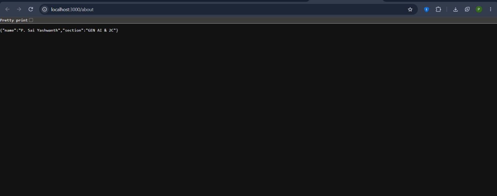
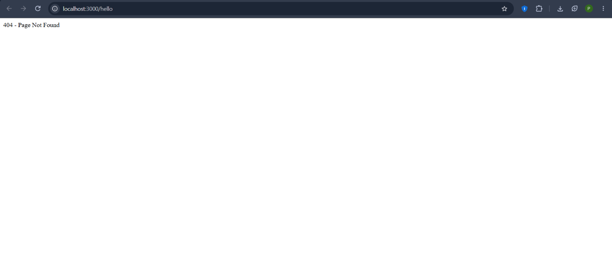

# Lab 1: Node.js and Express Server

**Name:** P. Sai Yashwanth  
**Section:** GEN AI & 2C

## Objective
To create a Node.js HTTP server and an Express server with multiple routes.

## Technologies Used
- Node.js
- Express.js
- JavaScript

## How to Run

1. Install Node.js.
2. Open the project folder in VS Code.
3. Install dependencies:

   ```bash
   npm install
   ```

4. Start the server:

   ```bash
   node index.js
   ```

5. Open http://localhost:3000 in your browser.

## Endpoints

| Method | Path | Description |
|---|---|---|
| GET | / | Displays the welcome message |
| GET | /about | Displays name and section in JSON |
| GET | /time | Displays current date and time |
| GET | /hello | Tests the 404 error response |

## Screenshots

### Home Page


### About Page


### Time Page


### 404 Error Page


## Notes
Successfully created and tested a Node.js HTTP server and an Express server.
