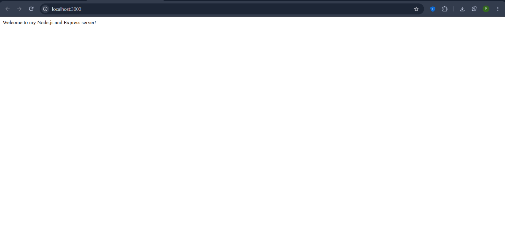
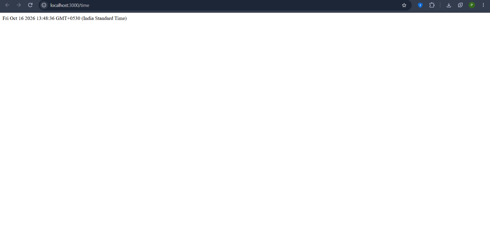

# Lab 1: Node.js and Express Server

## Student Details

- **Student Name:** P. Sai Yashwanth
- **Registration Number:** 252U1R9133
- **Section:** CSE GEN AI (2C)
- **Course:** Backend Development Fundamentals
- **Academic Term:** Year II – Term II
- **Faculty:** Joel Prashanth D

---

## Live Link

- **Deployment URL:** [https://backend-development-fundamentals-lab-01.onrender.com](https://backend-development-fundamentals-lab-01.onrender.com)
- **Deployment Platform:** Render (Web Service)
- **Deployment Status:** Live & Verified


---

## Objective

To set up a Node.js project and build a web server using the built-in HTTP module, then implement the same functionality using Express.js.

---

## Technologies Used

- Node.js
- Express.js
- JavaScript
- npm
- Git and GitHub

---

## Project Structure

```text
lab-01/
├── server.js
├── server-http.js
├── package.json
├── package-lock.json
├── README.md
├── .gitignore
└── screenshots/
    ├── home.png
    ├── about.png
    ├── time.png
    ├── not-found.png
    ├── terminal-server-running.png
    └── plain-http-server.png
```

---

## Prerequisites

- Node.js and npm installed.
- A web browser.
- Git installed for version control.

---

## Installation

Open a terminal inside the project directory and run:

```bash
npm install
```

This installs the dependencies listed in `package.json`.

---

## How to Run

### 1. Plain Node.js HTTP Server

Run:
```bash
node server-http.js
```

Open the following URL in your browser:
[http://localhost:3000](http://localhost:3000/)

**Expected response:**
```text
Hello
```

### 2. Express Server

> **Note:** Stop the plain HTTP server using `Ctrl + C` before starting the Express server. Both servers use port `3000`, so run only one at a time.

Run:
```bash
npm start
```

The server should start at:
[http://localhost:3000](http://localhost:3000/)

---

## Endpoints

| Method | Path | Description | Expected Status |
|---|---|---|---|
| GET | `/` | Returns the welcome message | 200 OK |
| GET | `/about` | Returns student name, registration number, and section as JSON | 200 OK |
| GET | `/time` | Returns the current date and time | 200 OK |
| GET | `/unknown` | Returns a not-found message for an undefined route | 404 Not Found |

*(Replace `localhost:3000` with the deployed base URL after deployment.)*

---

## Screenshots

The following screenshots document the actual output of the application:

### 1. Home Endpoint


### 2. About Endpoint


### 3. Current Date and Time


### 4. Unknown Route — 404


### 5. Express Server Running
*(Documented during local execution with `npm start`)*

### 6. Plain Node.js HTTP Server
*(Documented during local execution with `node server-http.js`)*

---

## Package Files

- **`package.json`:** Contains project metadata, scripts, and dependency declarations.
- **`package-lock.json`:** Records the resolved dependency versions.
- **`node_modules/`:** Contains installed packages and must not be committed to GitHub.

---

## Problems Faced and Solutions

- **Port already in use:** Stopped the other server before starting the current server when running both on port `3000`.
- **Express not installed:** Installed it using `npm install express`.
- **Incorrect route / 404 handling:** Added an undefined route handler (`app.use`) at the end of the middleware chain to return 404 with a meaningful message.

---

## Security and Repository Practices

- Do not commit `.env` files or private credentials.
- Do not commit `node_modules/`.
- Use meaningful Git commit messages.
- Verify the HTTP status codes returned by each route.

---

## GitHub Repository

[Backend Development Fundamentals — Lab 1](https://github.com/yashwanth012508/BDF-Labs)

---

## Conclusion

This lab demonstrates how to create a basic HTTP server using Node.js and implement routes using Express.js. The application is intended to return a welcome message, student information, the current date and time, and a 404 response for unknown routes.
